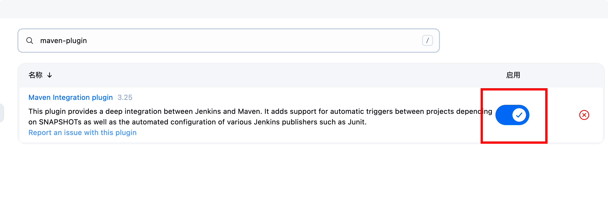
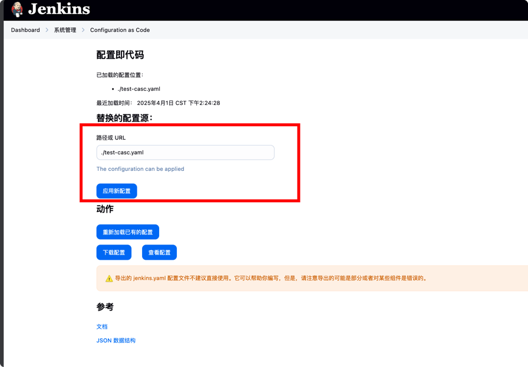
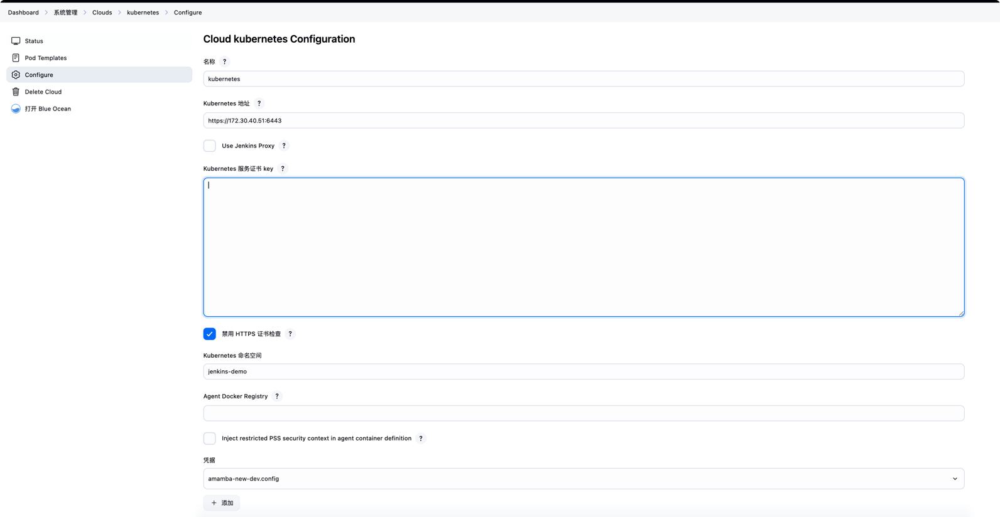

# 如何升级Jenkins及插件

## 升级流程

### 环境准备

> 本地需要准备java和go环境

1. 下载jenkins war包

   在 [jenkins官方仓库](https://github.com/jenkinsci/jenkins)的release页面找到指定的版本，下载war包；

```shell
JENKINS_VERSION=2.541.3
wget https://github.com/jenkinsci/jenkins/releases/download/jenkins-$JENKINS_VERSION/jenkins.war
```

1. 下载jenkins-plugin-manager的jar包

```shell
TOOL_VERSION=2.15.0
wget https://github.com/jenkinsci/plugin-installation-manager-tool/releases/download/$TOOL_VERSION/jenkins-plugin-manager-$TOOL_VERSION.jar
```

### 下载插件

注意：如果需要更新jenkins的版本，那同时需要更新formula.yaml, formula.core.yaml 中的jenkins war的版本。

下载jenkins-plugin-manager，使用此工具对插件进行管理：

```shell
JENKINS_HOME="jenkins_home" # 本地jenkins_home目录，jenkins的数据，密码等信息存放在这个目录中, 如果不指定，则默认为 ~/.jenkins
java -jar jenkins-plugin-manager-$TOOL_VERSION.jar  --war jenkins.war --plugin-download-directory $JENKINS_HOME/plugins -l --output yaml -f formula.core.yaml
```

> 虽然某些插件可能并没有在 formula.core.yaml 中声明，但是在下载插件时会下载依赖的插件，所以不用担心；😊

执行完以后可以在 $JENKINS\_HOME/plugins 目录下看到所有的插件；

### 启动jenkins

```shell
JENKINS_HOME="jenkins_home" java -jar jenkins.war
```

jenkins启动以后，通过 `http://localhost:8080` 访问jenkins；

jenkins的密码可以在控制台看到，或者在 $JENKINS\_HOME/secrets/initialAdminPassword 文件中查看；

> Tip: 初次进入jenkins时可能会直接重定向到 error 页面，这是因为jenkins的location配置不正确，需要修改。
> 在浏览器中输入 `http://localhost:8080/manage/` 进入系统配置，将 `Jenkins Location` 修改为 `http://localhost:8080/`；

### 更新插件

可以在jenkins的插件管理页面中查看相关的插件，按照需要更新/安装/卸载插件；

> 插件信息可以在 [jenkins插件中心](https://plugins.jenkins.io) 中进行查找

### 更新formula.yaml

如果有新增插件，注意需要在 formula.core.yaml 中添加. 是否添加为 core plugin可以根据插件页面中是否可以关闭来进行判断(如果不可以关闭，则不是core plugin,不需要添加到 formula.core.yaml 中,它会被自动下载)；


当通过页面更新完插件以后，执行以下命令将插件信息导出到yaml文件中；

```shell
java -jar jenkins-plugin-manager-$TOOL_VERSION.jar  --war jenkins.war --plugin-download-directory $JENKINS_HOME/plugins -l --output yaml > plugins.yaml

```

可以在 plugins.yaml 中看到所有的插件信息，现在需要将其和 formula.yaml 中的插件信息进行合并

执行以下命令

```shell
go run hack/update-formula/updateformula.go
```

> 注意查看日志中是否有错误信息输出，可能某些插件的groupID没有找到，那么需要手动在github的仓库中查找对应的插件的pom.xml文件，添加到  formula.new\.yaml 中；

执行完命令以后，会生成一份 formula.new\.yaml 文件，将其中的plugins部分拷贝到 formula.yaml 中即可；

### 本地验证

现在 formula.yaml 中的插件信息已经更新，可以基于新的 formula.yaml 文件重新构建jenkins的war包，然后验证功能是否正常, 执行以下命令进行构建：

```shell
jcli cwp --install-artifacts --config-path formula.yaml --batch-mode --show-progress  
```

> 构建的时候最好使用 java 8， 否则可能会报错：Unable to make field private final java.util.Comparator java.util.TreeMap.comparator accessible
> 通过 export JAVA\_HOME=/path/to/jdk 来指定构建和运行的jdk版本. 推荐的版本（构建war包时使用java 8, 运行时使用java 17）

构建完成后会在 `tmp/output/target` 目录下生成jenkins-1.0-SNAPSHOT.war文件，war包中已经包含了插件，可以直接运行；

```shell
java -jar tmp/output/target/jenkins-1.0-SNAPSHOT.war
```

之后进入jenkins中进行重新验证功能是否正确

### 容器环境验证

除了本地验证外，因为jenkins是部署在k8s集群中的，需要在k8s的环境中去进行验证（因为除了war包外，jenkins的行为还与casc, groovy, JAVA-OPTS 等配置有关，也需要进行验证），需要准备以下文件：

- **一个k8s集群及其kubeConfig文件**
- CASC.yaml 文件
  > 本文中的jenkins ip为172.30.40.51，需根据实际情况进行修改
  可以复制现有的CASC文件进行修改，主要修改以下配置：
  ```yaml
  jenkins:
    clouds:
      - kubernetes:
          credentialsId: k8s-service-account   # 连接k8s的凭证，创建方式看下文
          jenkinsTunnel: "172.30.40.51:50000"  # jenkins的tunnel地址，值为 ip:50000 （端口配置看下文）, 需要在集群上把 jenkins-agent的service端口暴露出来,nodePort为50000
          jenkinsUrl: "http://172.30.40.51:8080/" # jenkins的web地址，通过此地址可打开UI界面(jenkins的nodeport)
          serverUrl: https://172.30.40.51:6443  # 集群k8s apiServer的地址
          name: kubernetes
          namespace: jenkins-demo  # jenkins所在的namespace
          webSocket: true
  ```

启动jenkins

```shell
java -jar tmp/output/target/jenkins-1.0-SNAPSHOT.war   
```

#### 配置jenkins

1. 在 系统管理 -> 全局安全配置 -> 代理(TCP port for inbound agents ?) 中将禁用改为 “指定端口”，端口值为50000，点击保存
2. 在 系统管理 -> 凭据管理 -> 全局 中创建一个全局凭据，类型选择 “secret file”, 凭据名称为“k8s-service-account”（对应着casc文件里的“credentialsId”配置项），凭据的内容为k8s的kubeconfig
3. 在 系统管理 -> Configuration as Code 中导入CASC.yaml文件，如果无误点击 “应用新配置
   
4. 检察，在 系统管理 -> Clouds 中应该会出现一个 “kubernetes”, 点击进入 Configure 页面


填写 Kubernetes 服务证书 key。 它的值为k8s的kubeConfig文件中的 `certificate-authority-data`, 注意需要将其进行base64解码。

检查 【凭据】 选项，它的值为第二步中创建的凭据，值是kubeConfig文件名.

上面一系列步骤都准备就绪后，即可开始验证jenkins及其插件功能是否正常。

#### 验证插件

1. 创建一条pipeline，内容如下：

```groovy
pipeline {
  agent {
    node {
      label 'base'           # 为了验证是否能正常使用base agent
    }

  }
  stages {
    stage('Stage-sPhNA') {
      steps {
        script {
          def buildTime = new Date().format("yyyy-MM-dd HH:mm:ss", TimeZone.getTimeZone('Asia/Shanghai'))
          currentBuild.description = "本次构建时间 ${buildTime}"
          }

        }
      }
    }
  }
```

1. 点击构建，查看构建日志，确认是否正常构建

在构建的过程中可能会出现jnlp连接的错误，需要检查以下几点：

- jnlp镜像的版本，可以在dockerhub上选择合适的版本，例如 `jenkins/inbound-agent:jdk17`
- jnlp无法连接jenkins master，需要检查
  - 启动jenkins的时候JENKINS\_OPTS 是否包含 “-Djenkins.model.Jenkins.slaveAgentPort=50000”
  - jenkins的50000端口是否能连接，通过 `telnet jenkinsIP 50000` 进行检查
  - jnlp容器是否能够访问到jenkins的50000端口
  - casc文件中的 jenkinsTunnel 是否正确
  - 【配置jenkins】章节中的代理是否配置正确

如果配置正确，上述流水线应该可以正常运行。

### 常见问题

#### Mac 上切换 JDK 版本

构建 war 包推荐使用 Java 8，运行 Jenkins 推荐使用 Java 17。

查看已安装的 JDK：

```shell
/usr/libexec/java_home -V
```

临时切换 JDK（当前终端会话有效）：

```shell
# 切换到 Java 8
export JAVA_HOME=$(/usr/libexec/java_home -v 1.8)

# 切换到 Java 17
export JAVA_HOME=$(/usr/libexec/java_home -v 17)
```

#### 使用 ktctl 在本地验证 K8s 环境

如果要在本地运行 Jenkins，但需要 K8s 集群中的 agent 来执行流水线，可以使用 [ktctl](https://github.com/alibaba/kt-connect) 将集群流量转发到本地。

**1. 修改 CASC 配置**

使用 WebSocket 模式，让 agent 通过 HTTP 端口建立连接，不需要单独的 TCP 端口：

```yaml
jenkins:
  slaveAgentPort: 50000
  clouds:
    - kubernetes:
        jenkinsUrl: "http://<远程jenkins的Service地址>"   # 如 http://172.30.40.51:32715
        webSocket: true            # 启用 WebSocket 模式，不需要 jenkinsTunnel
```

> `webSocket: true` 由 Kubernetes 插件自动处理，会通过环境变量传递给 JNLP 容器，不需要手动修改 jnlp 的 args。

**2. 启动 ktctl exchange**

将集群中 Jenkins Service 的流量转发到本地 Jenkins：

```shell
# --expose 的端口号对应容器的 containerPort
sudo ktctl exchange <jenkins-service-name> --namespace <namespace> --expose 8080 --kubeconfig <kubeconfig>
```

> - `ktctl connect` 只支持本机访问集群（单向），集群内的 Pod 无法访问本机
> - `ktctl exchange` 可以将集群 Service 的流量转发到本机（双向）

**3. 在本地 Jenkins 中导入 CASC 配置，运行流水线验证**
